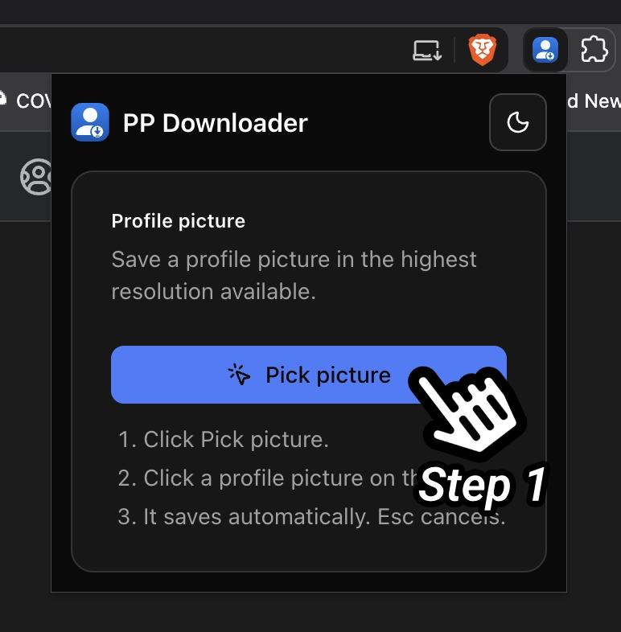
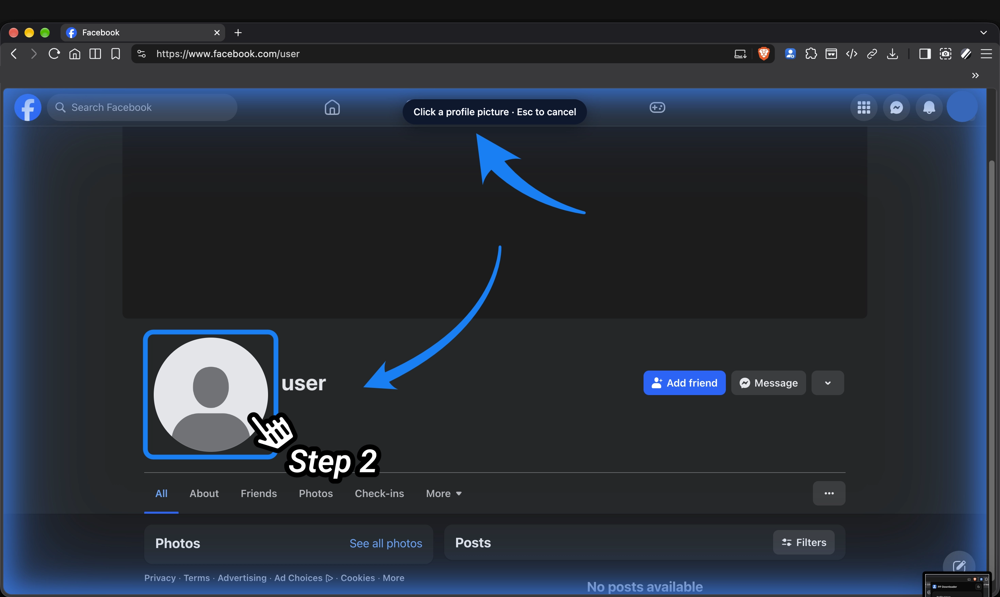

<p align="center"></p>

# PP Downloader

Browser extension (Chrome, Firefox) that saves Facebook profile pictures in the highest resolution available.

## Usage

1. Open Facebook and click the extension icon, then **Pick picture**.

   

2. Click a profile picture on the page. It saves automatically; Esc cancels.

   

Feed and suggestion thumbnails only exist in low resolution. For those, the extension offers to open the profile so you can pick the full-size picture there.

## Disclaimer

PP Downloader is an independent project. It is not affiliated with, endorsed by, or sponsored by Meta Platforms, Inc. Facebook is a trademark of Meta Platforms, Inc. Use it only on content you are allowed to access, and follow Facebook's terms.

## License

[MIT](LICENSE)

## Stack

WXT (Vite managed by WXT) · React 19 · TypeScript (strict) · Tailwind CSS v4 · shadcn/ui · Lucide · Vitest · Biome · pnpm · GitHub Actions

See [docs/architecture.md](docs/architecture.md) for the decisions and [docs/browser-compatibility.md](docs/browser-compatibility.md) for targets and limits.

## Setup

```bash
pnpm install        # also runs `wxt prepare`
pnpm dev            # Chrome with HMR
pnpm dev:firefox    # Firefox (MV3) with HMR
```

## Scripts

| Script                              | Purpose                             |
| ----------------------------------- | ----------------------------------- |
| `pnpm compile`                      | Type check                          |
| `pnpm lint` / `pnpm format` | Biome check (lint, format, imports) / auto-fix |
| `pnpm test`                         | Vitest unit tests                   |
| `pnpm build` / `pnpm build:firefox` | Production builds into `.output/`   |
| `pnpm lint:firefox`                 | `web-ext lint` on the Firefox build |
| `pnpm zip` / `pnpm zip:firefox`     | Store-ready zips                    |

CI (`.github/workflows/ci.yml`) runs all of the above except the dev servers and zips.

## Loading the build manually

- Chrome: `pnpm build`, then `chrome://extensions` → Developer mode → Load unpacked → `.output/chrome-mv3`.
- Firefox: `pnpm build:firefox`, then `about:debugging#/runtime/this-firefox` → Load Temporary Add-on → `.output/firefox-mv3/manifest.json`.

## UI and theming

- **Components:** shadcn/ui (new-york style, neutral base) in `src/components/ui/`. The source is ours to edit; there is no runtime component library. Add more with `pnpm dlx shadcn@latest add <component>`, which reads `components.json`. Check that imports use `@/lib/utils` after generation.
- **Color tokens:** `src/assets/styles/theme.css`, OKLCH semantic variables for `:root` (light) and `.dark`. Change the accent by editing `--primary`, `--primary-foreground` and `--ring` in both blocks. Use semantic utilities (`bg-background`, `text-muted-foreground`, `border-border`) and never raw colors in components.
- **Theme behavior:** `src/lib/theme.ts` and `src/hooks/use-theme.ts`. `system` follows the OS; an explicit light/dark choice is stored in `browser.storage.local` under `theme` and syncs to every open extension page.
- **Adding a page** (options, etc.): import `@/assets/styles/theme.css` and call `watchTheme`/`applyTheme` the same way `src/entrypoints/popup/main.tsx` does.

## Branding assets

- Screenshots: `docs/assets/screenshots/` (numbered in usage order).
- Master logo: `src/assets/branding/icon.svg` (used in the popup header).
- Extension icons: `public/icon/{16,32,48,96,128}.png`, rendered from the master SVG.
- Repo logo and social preview: `docs/assets/logo.png` (512×512) and `docs/assets/social-preview.png` (1280×640). Upload the social preview under GitHub → Settings → Social preview; it cannot be set from the repo.
